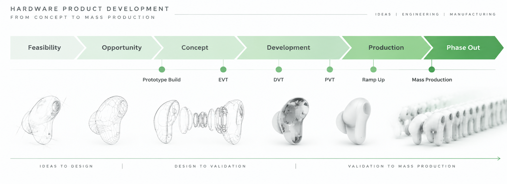

# From Concept to Mass Production

Practical engineering insights on building hardware products — from early concepts to global mass production.

---

## About

I'm @PD-Roger, a mechanical engineer with 20+ years of experience in global manufacturing and consumer electronics product development.

I've worked across the complete product lifecycle — from early concepts and mechanical design to engineering validation, production ramp, and mass production.

My experience includes products such as headsets, speakers, smart glasses, and other consumer electronics for global brands.

My work focuses on bridging the gap between product design and manufacturing execution:

- Mechanical Design & DFMA
- NPI and Product Industrialization
- Injection Molding & Tooling
- Materials and Manufacturing Processes
- FMEA, DOE, PPAP
- SPC, CP/CPK, GR&R
- Product Validation
- Production Readiness

Throughout my career, I've collaborated with industrial design, engineering, manufacturing, quality, suppliers, and program teams to deliver products that are manufacturable, reliable, and scalable.

This repository is a collection of engineering notes, lessons learned, and practical methods from real product development projects.

---

## Categories

### [01 · Product Development & Program Management](./01-project-management)

APQP, NPI, risk management, product development processes, and cross-functional execution.

### [02 · Mechanical Design & DFMA](./02-mechanical-design-dfma)

Mechanical design fundamentals, design optimization, tolerance, assembly, and manufacturability.

### [03 · Tooling, Molding & Materials](./03-tooling-material)

Injection molding, tooling development, surface texture, gating, heat staking, and material selection.

### [04 · Process & Quality](./04-process-quality)

Process development, DOE, SPC, CPK, GR&R, PPAP, and manufacturing quality.

### [05 · Secondary Process Development](./05-secondary-process)

Adhesives, PSA, painting, coating, and cosmetic process development.

### [06 · Career Development](./06-career-growth)

Engineering growth, leadership, interviews, and professional development.

### [07 · Notes & Reflections](./07-life-thinking)

Thoughts on cost, innovation, engineering decisions, and continuous learning.

---

## Background

- M.S. Mechanical Engineering
- MBA
- Six Sigma Black Belt
- CMQ/OE
- PMP

## Contact

Email: roger_yang@outlook.com

LinkedIn: https://www.linkedin.com/in/npdroger/

---

> From concept to mass production — long, messy, and worth it.
